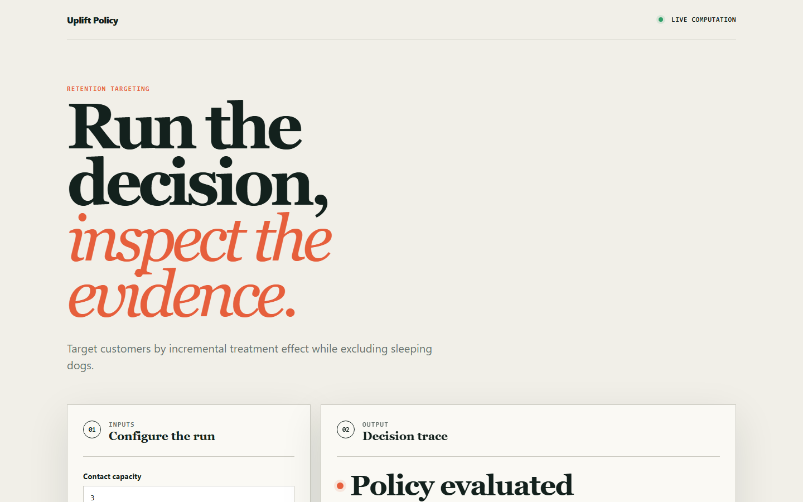
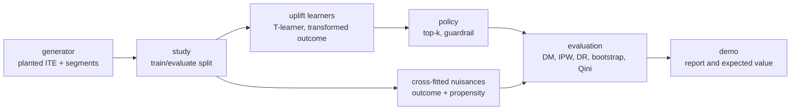

# upliftpolicy

> Retention targeting by uplift with doubly-robust policy evaluation, including the customers your outreach drives away.

[](https://github.com/SlateGitOrg/upliftpolicy/actions/workflows/ci.yml)
[Live demo](https://slategitorg.github.io/upliftpolicy/)



## Why

A retention team builds a churn model and sends a discount to everyone with a high churn score. Many of those customers were going to churn regardless, so the discount is wasted. Others were never going to leave but happily accept it. Worse, some customers are made *more* likely to leave by being contacted (sleeping dogs). A propensity model has no notion of the intervention, so it cannot represent them, and the campaign can lose money while appearing to succeed.

This project models uplift (the individual treatment effect of contact) instead, and evaluates targeting policies with a doubly-robust off-policy estimator.

## Features

- Synthetic generator with a known individual treatment effect and four segments: persuadable, sure thing, lost cause, sleeping dog.
- Confounded campaign log (contact rate rises with risk), as in real campaigns.
- Uplift learners behind one harness: a T-learner and a transformed-outcome learner, both on hand-written logistic regression (IRLS).
- Direct-method, IPW and doubly-robust policy-value estimators with cross-fitted nuisance models and bootstrap confidence intervals.
- Qini-style incremental curve, segment mix of each contact list, and a guardrail that never contacts customers with negative estimated uplift.
- Expected-value calculation per 1,000 customers from stated unit economics.
- Browser app (in `site/`) that runs the decision workflow interactively.

## Architecture



The generator produces a population with known treatment effects. `study` fits learners on one half of the log and evaluates the implied policy on the other, using cross-fitted nuisance models. `evaluation` scores policies three ways (DM, IPW, DR). See [docs/ARCHITECTURE.md](docs/ARCHITECTURE.md).

## Quick start

Requires Python 3.11+. There are no dependencies to install.

```bash
git clone https://github.com/SlateGitOrg/upliftpolicy.git
cd upliftpolicy
python -m unittest discover -s tests -v   # 34 tests, about 2 s
python -m src.demo                        # full report, tens of seconds
```

The browser app needs Node 24 only for its tests: `node --test site/core.test.mjs`.

## Example

Trimmed output of `python -m src.demo`:

```text
3. THE HEADLINE -- top 30% by churn vs top 30% by uplift
policy                     true V     DR V              DR 95% CI
top-30% by churn score     0.6113   0.5990   [0.5765, 0.6221]
top-30% by uplift          0.6583   0.6492   [0.6265, 0.6706]
Incremental retention vs doing nothing (true):
  churn-ranked  :   -0.23%  <- the campaign DESTROYS retention
  uplift-ranked :   +4.47%

policy                   contacts   contact cost   net GBP/1000
top-30% by churn score        900   GBP    10800   GBP    -4376
top-30% by uplift             900   GBP    10800   GBP   +11599
```

On a seeded synthetic book of 3,000 evaluated customers, contacting the top 30% by uplift adds 4.47 points of retention, while the top 30% by churn score loses 0.23 points. Sleeping dogs are 37% of the churn-ranked list (336 of 900) and 4% of the uplift-ranked list (40 of 900). The GBP 12 per contact and GBP 340 per retained subscriber are illustrative.

## How it works

- **Uplift** is P(stay | contact) minus P(stay | no contact), estimated by a T-learner (separate arm models) and a transformed-outcome learner.
- **Policy value** is estimated off-policy. The DR estimator combines an outcome model with inverse-propensity weights and stays accurate if either is wrong.
- **Evaluation protocol** (`src/study.py`): train/evaluate split plus cross-fitting, because evaluating on the fitting half inflated DR by about 0.8 points over 30 seeds.
- **Guardrail**: customers with negative estimated uplift are never targeted, whatever their churn score.

## Measured results

From `python -m src.demo` (n=6000 log, 3000 train / 3000 evaluate, seed 7, deterministic; 16 s of CPU, 37 s wall-clock on an unloaded laptop):

| Metric | Value |
|---|---|
| Pearson r(T-learner uplift, true ITE) | +0.638 |
| Pearson r(transformed-outcome uplift, true ITE) | +0.630 |
| Pearson r(churn score, true ITE) | -0.143 |
| True value: do nothing / top-30% churn / top-30% uplift | 0.6136 / 0.6113 / 0.6583 |
| DR estimate (95% bootstrap CI), top-30% uplift | 0.6492 [0.6265, 0.6706] |
| Incremental retention, churn-ranked vs uplift-ranked | -0.23% vs +4.47% |
| Sleeping dogs on the 900-contact list, churn vs uplift | 336 vs 40 |
| Net value per 1,000 customers (GBP 12 contact, GBP 340 LTV) | -4,376 vs +11,599 |
| Qini-style area (DR incremental curve), uplift vs churn | 0.0479 vs 0.0164 (2.92x) |
| Mean estimated uplift, sleeping-dog segment (true -20%) | -10.0% |
| Individuals whose uplift CI covers zero (B=25 refits) | 43.4% |

Off-policy estimator RMSE over 5 independent logs, top-30% uplift policy:

| Scenario | DM | IPW | DR |
|---|---|---|---|
| both nuisance models sound | 0.93% | 0.56% | 0.52% |
| outcome model misspecified (intercept only) | 1.50% | 0.56% | 0.49% |
| propensity misspecified (assume 50/50) | 0.93% | 20.83% | 0.49% |
| both misspecified | 1.50% | 20.83% | 4.36% |

The suite (`tests/`) checks: uplift correlation with the planted ITE above 0.35 (the worst of a 10-seed sweep was 0.40); the sleeping-dog segment has the lowest mean estimated uplift, and it is negative; DR recovers the oracle policy value within 3 SE; IPW with a naive propensity is off by more than 10 SE; DR survives either single misspecification; and, averaged over 6 seeds, DR is biased when both are wrong.

## Limitations

- Synthetic data only. Criteo-UPLIFT and Hillstrom validation is not implemented.
- Learners are logistic-regression based (T-learner, transformed outcome). There is no causal forest or R-learner. The T-learner overstates lost-cause uplift (+13.6% estimated vs +1% true) because the arm models are linear in the features and the segment structure is not.
- Individual precision is limited: 43.4% of customers have a bootstrap uplift interval that covers zero. That interval comes from only 25 refits, which kept the demo within its time budget, so its percentile endpoints are coarse.
- Policy-value bootstrap CIs hold the fitted nuisance models fixed, so they understate uncertainty from nuisance estimation.
- A single seed cannot resolve DR bias below about 3 SE (0.017 at n=1500). Bias claims are tested across seeds for that reason. Even over 6 seeds, the direct method with an intercept-only outcome model showed a mean error of -0.87 points at 1.9 SE, so the suite makes no DM-bias claim.
- The expected-value calculation uses stated illustrative unit economics, not real ones. There is no HTTP service; the demo prints the calculation.


## Testing

```bash
python -m unittest discover -s tests -v
```

Tests assert behaviour, not just execution: recovered uplift correlates with the planted effect above a threshold, the sleeping-dog segment has the lowest (negative) estimated uplift, DR recovers the oracle policy value within 3 SE, IPW with a naive propensity fails, and the generator and linear algebra routines are checked directly.

## Project layout

```text
src/         generator, linalg, uplift learners, policy, evaluation, study, demo
tests/       unit and recovery tests
site/        browser app (core.mjs logic, core.test.mjs)
scripts/     site validation
docs/        architecture notes and screenshots
```

## License

MIT — see [LICENSE](LICENSE).
