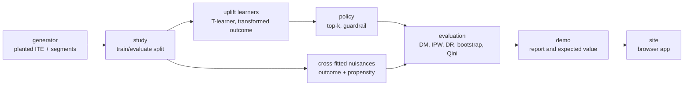

# Architecture

## Context

Retention teams usually rank customers by churn probability and contact the top
of the list. That ranks by risk, not by whether the contact changes the outcome.
`upliftpolicy` estimates the effect of contact on each customer (uplift),
evaluates the resulting targeting policy off-policy from a confounded campaign
log, and turns the result into expected value per 1,000 customers.

## Component view

Everything is pure Python standard library (`src/linalg.py` holds the small
linear-algebra and logistic-regression IRLS routines). The browser app in
`site/` re-implements the decision workflow in JavaScript (`site/core.mjs`).

## Key decisions

- **Planted ground truth.** The generator assigns each customer a known
  individual treatment effect and a segment (persuadable, sure thing, lost
  cause, sleeping dog). Recovery can be tested against the truth, which real
  data never allows.
- **Confounded log.** Contact probability rises with risk, as in a real
  campaign, so naive comparisons are biased and propensity correction matters.
- **Train/evaluate split.** The policy is fitted on one half and evaluated on
  the other. Fitting and evaluating on the same half inflated the DR estimate
  by about 0.8 retention points over 30 seeds (see `src/study.py`).
- **Cross-fitted nuisances.** Outcome and propensity predictions for each
  evaluation customer come from folds that did not contain them.
- **Doubly robust evaluation.** DR stays accurate if either nuisance model is
  wrong; IPW and DM each fail in one of the two cases (table in the README).
- **Guardrail.** `apply_sleeping_dog_guardrail` removes any customer with
  negative estimated uplift from the contact list regardless of churn score.

## Failure modes

- Both nuisance models wrong: DR is biased too. The test suite asserts this
  rather than hiding it.
- Linear arm models overstate lost-cause uplift (+13.6% estimated vs +1% true).
- Individual intervals are wide: 43.4% of customers have a bootstrap interval
  covering zero, computed from only 25 refits.
- Bootstrap CIs for policy value hold the fitted nuisances fixed, so they
  understate nuisance uncertainty.

## Out of scope

Real datasets (Criteo-UPLIFT, Hillstrom), causal forests, R- and X-learners, an
HTTP scoring service and persistent storage.
